# 002 — Factory overview

**Repo:** `marge-web` (client `client/`, server `server/`). Base branch: `main` (repo default; no `develop`).
**Built on:** `main` @ `5816e46` (design 001 built and merged). **Factory read at:** `~/playola/factory` @ `bdba83a`.

## Who and why

**Who:** Brian and the few allowlisted Playola operators from design 001, mostly checking from a phone.

**Intent:** Replace the "Control panel not built yet" body of `/factory` with a live, read-only list of every design the
factory is building, so one glance answers "what's in flight, and does any of it need me or look stuck?". Anything
that would cloud that answer waits for a later design.

**Out of scope:**

- **Design 003:** a detail screen for one build (event history, review findings, videos). It reads the history 002
  starts keeping (decision 20).
- **Design 004:** actions (restart a paused repo, give up a design) and any command from marge back to the factory
  machine.
- **The factory's sender:** `factory watch` building and pushing the sync (latest state, status list and history).
  It lives in the factory repo and gets its own spec there (decision 3).
- No "coming soon" placeholders for any of these.

**Realistic sizes:**

- Builds in flight: ≤ 8 today (one per watched repo); the server accepts up to 50.
- Stages per build: 5 today, up to about 7.
- The not-in-flight counts reach the hundreds for "Done".
- One snapshot is under 20 KB.

## Screens

Canvas: `design/marge.pen`, zone "002 — Factory overview (D) — states". Every state is drawn at desktop (1440 wide) and
phone (390 wide). All states share the 001 header ("← marge / Software Factory", email, Sign out) and the
"Software Factory" heading.

**Address:** `/factory` (signed in only, as in 001).
**Reached by:** the title screen's "Software Factory" item, or the address directly.
**Left by:**

- "← marge" goes to `/home`.
- "Sign out" goes to `/`.
- "Open PR #N ↗" opens the pull request on GitHub in a new tab.

**What a build row shows:**

- A status chip.
- The design: number and name.
- The repo's short name and "PR x of y".
- The factory's stage track with the current stage lit in the status colour.
- The factory's one-line reason.
- "Last news … ago".
- An "Open PR #N ↗" button, only on "needs you" rows that have a pull request.

**Only running builds move** (decision 18). A running chip has a dot that pulses. A soft highlight sweeps along its
current stage segment. The drawings show these as the dot in the chip and the lighter patch on the segment. Every
other row is completely still.

On phone each build is a card. The track drops its labels there, and the reason line reads
"<Stage> · PR x of y — <reason>".

### Overview — normal

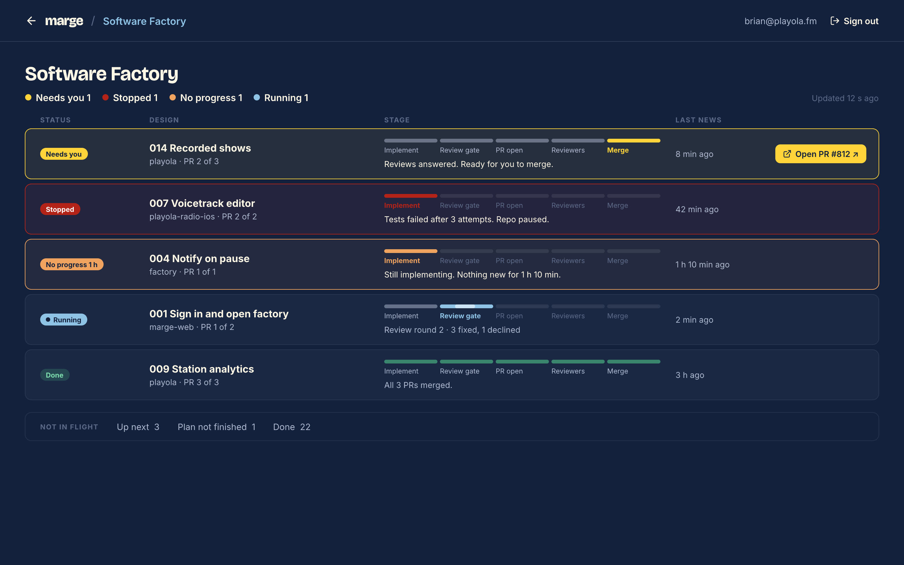
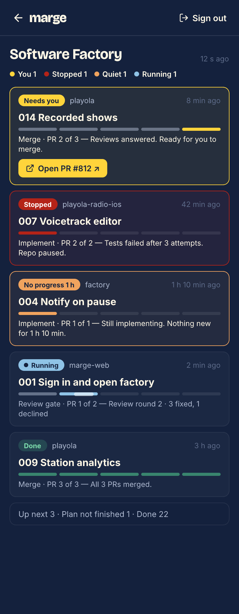

**The count line** sits under the heading and lists each status present, in sort order, as the status's label then
its count, like the footer. Desktop reads "Needs you 1 · Stopped 1 · No progress 1 · Running 1"; phone reads
"You 1 · Stopped 1 · Quiet 1 · Running 1". It is followed by "Updated 12 s ago". Done builds are not counted here,
because the line answers "what's in flight?".

**Rows** are sorted by decision 7. Each status's look comes from its role in the factory's status list (decision 5).
The factory's statuses today:

| Status (role)           | Chip                                                         | Row edge |
| ----------------------- | ------------------------------------------------------------ | -------- |
| Needs you (`attention`) | yellow                                                       | yellow   |
| Stopped (`failure`)     | red                                                          | red      |
| No progress (`quiet`)   | orange, reading "No progress 1 h" (the time since last news) | orange   |
| Running (`active`)      | blue, with a pulsing dot; the current segment shimmers       | none     |
| Done (`complete`)       | soft green ("Done"); every segment of the track is green     | none     |

Done rows are builds the factory finished in the last 24 hours (decision 19). They sit last and never show a
button.

**The footer** "NOT IN FLIGHT Up next 3 · Plan not finished 1 · Done 22" closes the list.

### Overview — busy

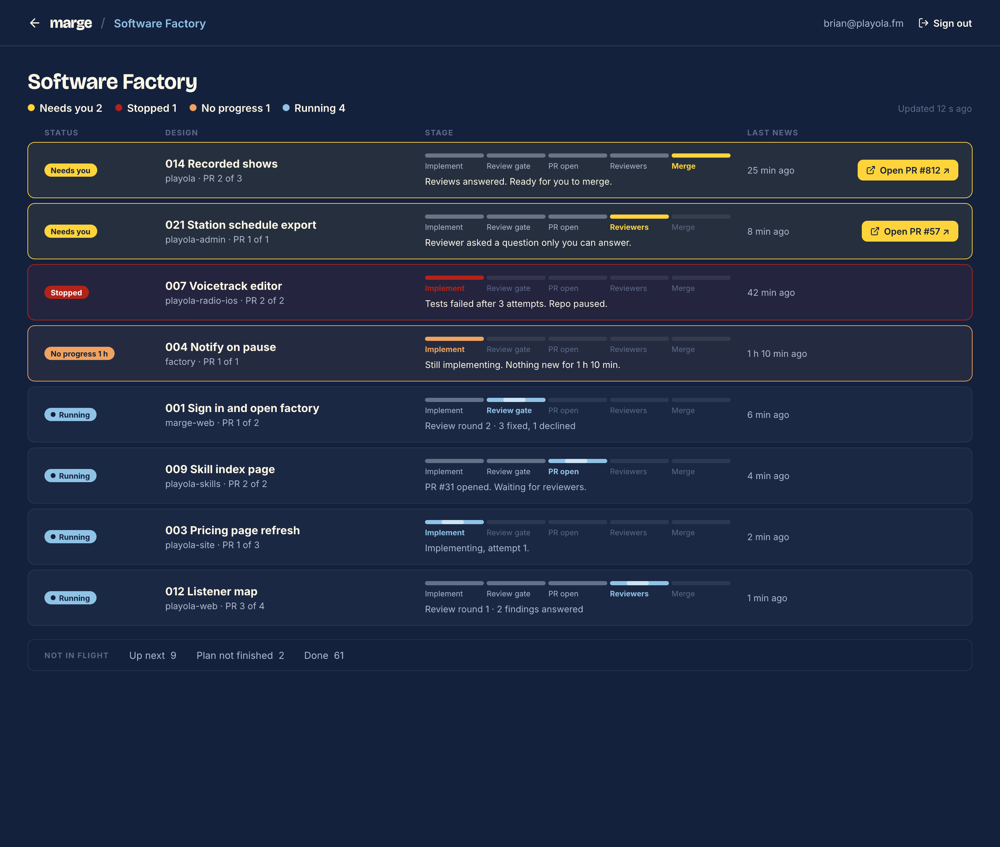
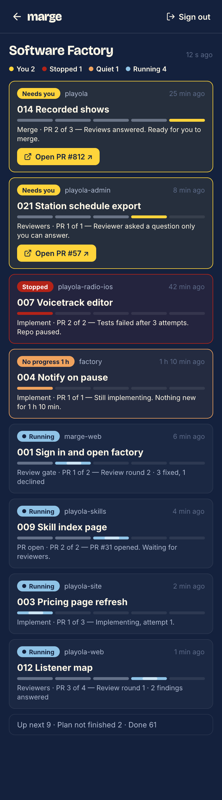

Eight builds at once, two of them needing you. This is the realistic upper size: the page scrolls, it does not
paginate, and there is no search.

### Overview — out of date

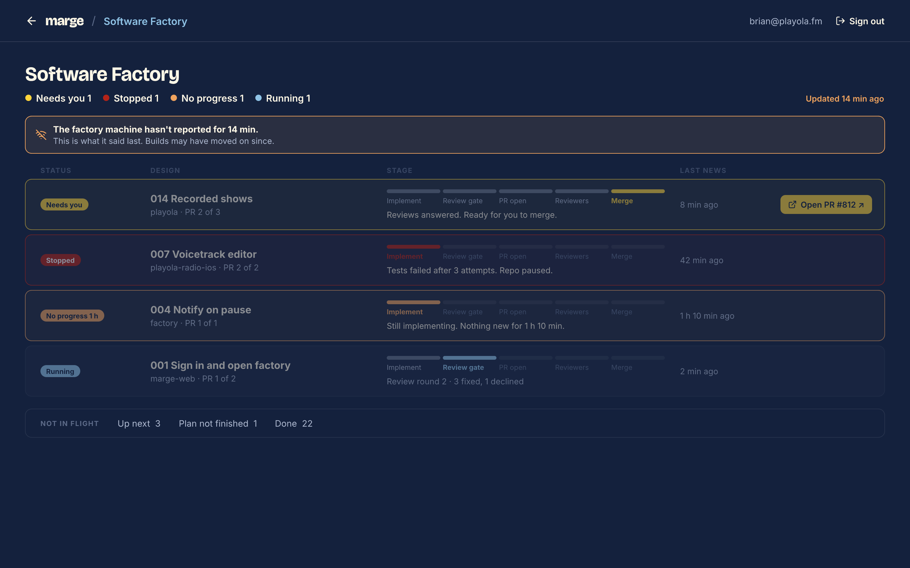
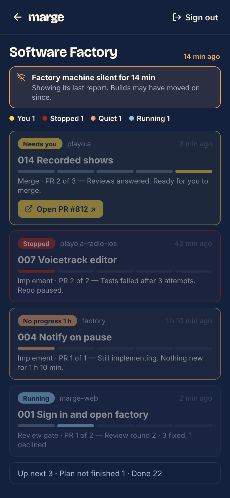

Shown when the latest report reached marge more than 3 minutes ago (decision 8).

- **Banner:** "The factory machine hasn't reported for 14 min." with "This is what it said last. Builds may have
  moved on since."
- **Banner on phone:** "Factory machine silent for 14 min" with "Showing its last report. Builds may have moved on
  since."
- "Updated 14 min ago" turns orange.
- The last list stays visible at half opacity, with its buttons still working.
- Nothing moves. Running rows lose their pulsing dot and shimmer, because marge can't vouch that anything is still
  moving.

### Overview — nothing in flight

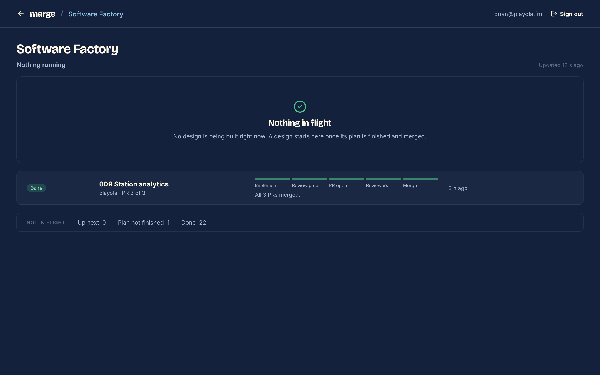
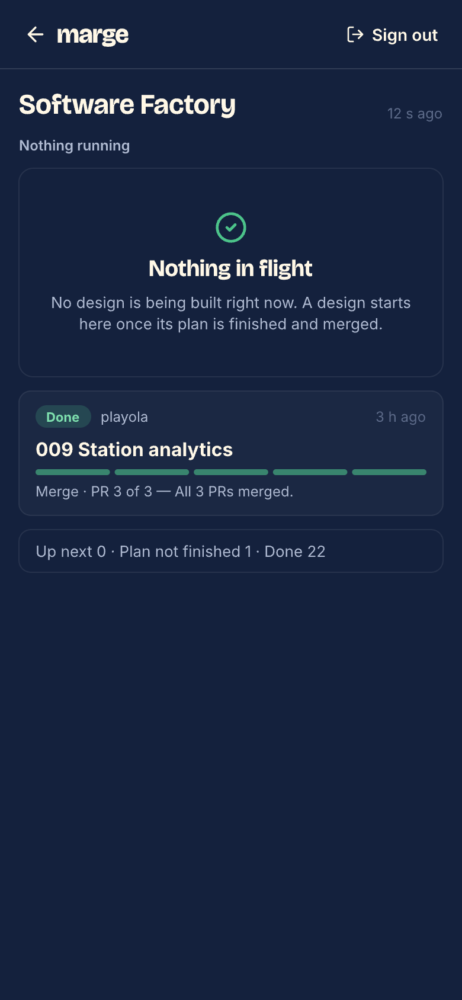

The factory reported no builds except done ones.

- Under the heading it reads "Nothing running".
- The panel reads "Nothing in flight" with "No design is being built right now. A design starts here once its plan
  is finished and merged."
- Builds finished in the last 24 hours are listed below the panel (one is drawn). With none, the panel stands
  alone.
- The footer counts still show.

### Overview — not connected yet

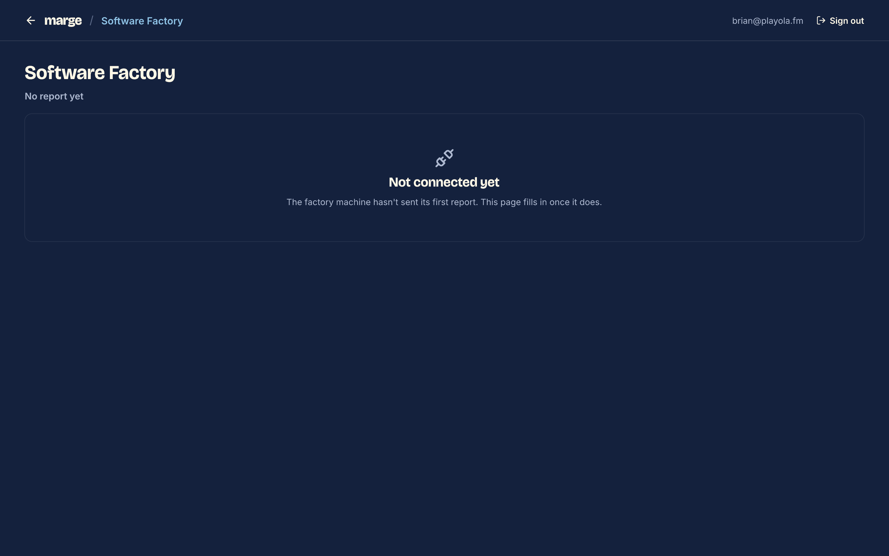
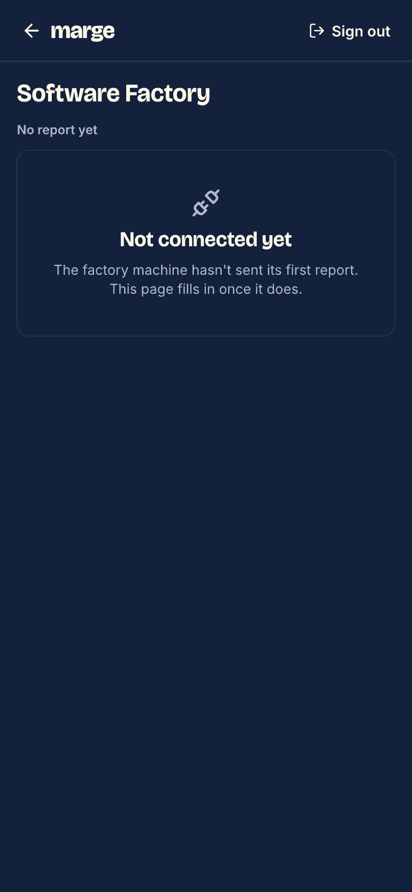

The factory has never reported (`snapshot: null`), for example before its sender ships. Under the heading it reads
"No report yet", and the panel reads "Not connected yet" with "The factory machine hasn't sent its first report. This
page fills in once it does." There is no "Updated" time and no footer.

### Overview — loading

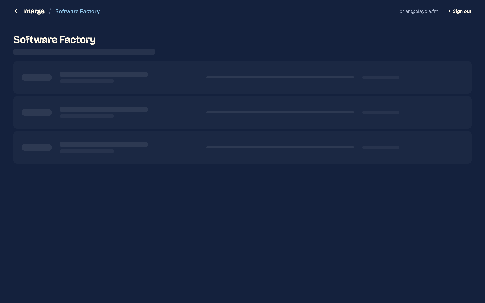
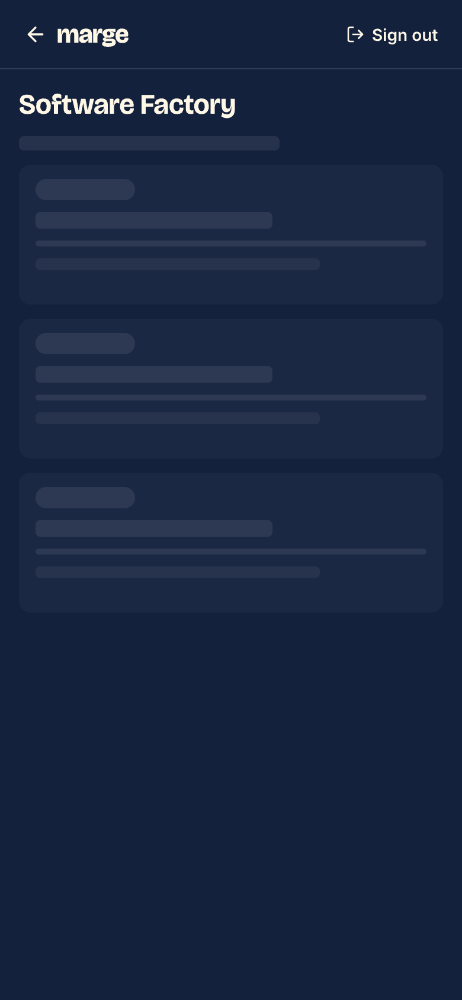

Shown only on the page's first fetch: a placeholder bar for the count line and three placeholder rows. Later refreshes
happen without it.

### Overview — couldn't load

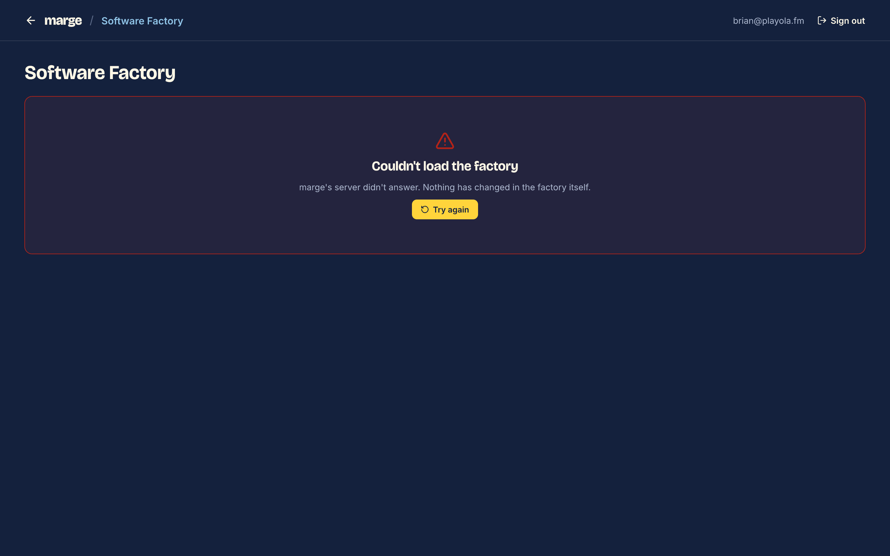
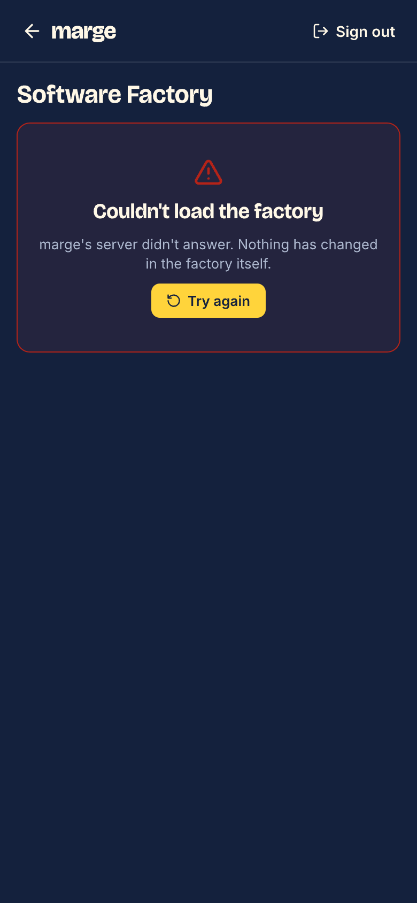

Shown when any fetch fails (network failure or a 500). The panel reads "Couldn't load the factory" with "marge's
server didn't answer. Nothing has changed in the factory itself." and a "Try again" button. "Try again" fetches at
once. Polling also keeps going, so the page recovers by itself.

**Not drawn:**

- **A status whose role marge doesn't know:** the same row as running, with the factory's label on a grey chip, no
  coloured edge and no motion (decision 6).
- **Signed out or expired:** handled by design 001's redirect. A 401 from the server is treated the same way
  (decision 15).

## Decisions

1. **Read-only first.** 002 shows the overview only; 003 adds the detail screen and 004 the actions. The only control
   on a row is the "Open PR" link. Restart, See log, row chevrons and "Show all" from the early drafts were removed, not
   disabled.
2. **Layout: the flight list (direction D).** One row per build, with columns Status, Design, Stage, Last news and
   Action on desktop, and stacked cards on phone. It was chosen over a board, lanes, an inbox, a wall and a timeline
   because status and "needs me?" read first.
3. **Two repos, built separately.** The factory builds only in the repo that holds the design, so this folder covers
   marge-web only: the server endpoints and the page. The sender lives in `factory watch` (the only process that knows
   which repos are paused; that state is held only in its memory) and is specced and built in the factory repo. The
   owner chose this over building the sender by hand alongside this design. Until it ships, the page shows
   "Not connected yet".
4. **The factory decides; marge displays.** These all come from the factory:
   - the list of statuses (decision 5)
   - the stage names and how many there are
   - the current stage
   - each build's status, including "no progress" (no event for 60 minutes)
   - the reason line
   - "PR x of y" and the pull request link

   Marge never works a status out from events and never recomputes any of these. A PR's or design's status is not
   "whatever the latest event says": the factory's own log has retries and repeated review rounds, so the factory's
   state machine decides and marge shows the result. Marge computes only how fresh the report is (decision 8).

5. **The factory owns the status list.** Every push carries the list (ApiContract.md → Catalog): each status's key,
   label, phone label and role, in sort order. To add, rename or reorder a status, the owner changes the factory, and
   the page follows on the next push. Marge has no status list of its own and no screen for editing one: a status
   that existed only in marge could never be reached by a build. The factory never sends colours; marge maps each
   role to its look:
   - `attention`: yellow (`$sun`), coloured edge
   - `failure`: red (`$danger`), coloured edge
   - `quiet`: orange (`#F0A35E`), coloured edge; the chip adds the hours since last news
   - `active`: blue (`$sky`), the only role that moves (decision 18)
   - `complete`: soft green (`#4CC38A33` chip with `#7EE0AE` text; track `#4CC38A99`); not in flight, so not in the
     count line (decision 19)

   Chosen by the owner over a list marge keeps and edits itself.

6. **A role marge doesn't know shows grey.** If the factory sends a role marge has no look for (say a future
   `waiting`), the status still shows with the factory's label, on a grey chip (`$muted` on `$ink`) with no coloured
   edge and no motion, in the factory's order, and is counted in the count line. A build can never carry a status
   missing from the list: the server refuses such a push (ApiContract.md → Snapshot).
7. **Sort:**
   - Builds whose status has role `complete` always come last, whatever their place in the list (the nothing-in-flight
     state draws them below its panel, so they must form one final group).
   - Otherwise status first, in the order of the factory's list.
   - Then the longest without news first (`lastEventAt` oldest first).
   - Then `repo`, then `designNumber`.
8. **Freshness belongs to marge.** The factory pushes on every change, plus a heartbeat every 60 seconds that it sends
   only after a completed state scan, so a stuck watcher goes quiet instead of looking healthy. Marge stamps each
   report with its own `receivedAt`, and the page is out of date when `serverNow − receivedAt` passes **3 minutes**.
   All ages use the server's clock; only "Last news" depends on the Mac's clock too (ApiContract.md → GET).
9. **Transport: the Mac pushes; marge keeps the latest state and the history.**
   - `POST /v1/factory/sync` with a dedicated bearer token. A shared token is enough for one sender of read-only
     status; HMAC and replay checks were considered and left out.
   - The latest state and status list go in one `kv_store` row (`factory:snapshot`, 365-day TTL, so the last report
     survives any realistic outage), replaced on every push.
   - New events and reports are added to two tables (ModelChanges.md, decision 20).
10. **Refreshing:**
    - The page fetches every 30 seconds while the tab is visible, stops while it is hidden, and fetches at once when it
      becomes visible again. A page opened in a hidden tab makes its first fetch only once it is shown.
    - Loading placeholders appear only on the first fetch.
    - A failed fetch shows "Couldn't load", and the next successful fetch replaces it. A fetch with no answer after
      15 seconds counts as failed.
    - Ages are worked out when each answer arrives and change only with the next fetch. There is no ticking clock
      between fetches, so the "Updated" time can lag by up to 30 seconds.
11. **"Not connected yet" is its own state.** It is never shown as "Nothing in flight", which would claim the factory is
    idle when marge simply hasn't heard from it.
12. **Setup happens during design, not in the build** (as in 001 decision 13). Before this folder is handed to the
    factory, the owner:
    - generates `FACTORY_REPORT_TOKEN` and adds it to Render's `production` env group;
    - keeps the same value for the factory machine's `~/.factory/env`.

    The PRs only declare the setting.

13. **Not-in-flight footer: Up next, Plan not finished, Done.** The factory can count these from `factory/ready/` and
    `factory/done/`. "Designing" and "Idle repos" from the drafts were dropped: the factory can't see a design that
    is still being drawn, and an idle repo isn't news.
14. **Phone wording is shorter**, so the count line fits on one line at 390 wide:
    - count line: each status's phone label from the factory's list ("You" for needs you, "Quiet" for no progress)
    - out-of-date banner: "Factory machine silent for 14 min"
    - "Updated" time: "14 min ago"
15. **Sign-in is 001's.** Signed-out visits redirect as in 001. A 401 from `GET /v1/factory/snapshot` (for example
    after `JWT_SECRET` is rotated) clears the stored session and goes to `/?redirectTo=%2Ffactory`. The marge token
    and the factory token are never interchangeable.
16. **How ages read** (the "Updated" time, "Last news" and the no-progress chip), all whole numbers rounded down:
    - under a minute: "12 s"
    - under an hour: "42 min"
    - an hour or more: "1 h 10 min", or "2 h" on the exact hour
    - The no-progress chip shows whole hours only: "No progress 1 h".
17. **One known gap.** If a single build's events stop but the watcher keeps scanning, that build turns "no progress"
    after 60 minutes while the page stays fresh. That is intended: the page is stale only when the whole factory
    goes quiet.
18. **Only running builds move** (the `active` role). The owner wants to see at a glance what is churning and what
    is paused, stopped or done. A running chip has a pulsing dot, and a soft highlight sweeps along its current stage segment, about
    once every 2 seconds. Nothing else animates, so stillness means nothing is happening. Motion is off when the
    page is out of date (marge can't vouch for it) and when the device asks for reduced motion. Chosen by the owner
    over animating every in-progress status.
19. **Recent finishes show as `done`.** The factory includes builds it finished in the last 24 hours with status
    `done` (role `complete`). They sort last, show a green chip and a fully green track, never move, never show a
    button, and are not in the count line. After 24 hours the factory stops sending them and they leave the list;
    the footer's "Done" count keeps the total. Chosen by the owner over leaving finished builds off the page.
20. **Marge keeps the build history from now on, but shows none of it yet.** Every event the factory reports, and
    every report (implementation, review gate, reviews) those events point to, is stored in marge
    (ModelChanges.md). Design 003's detail screen reads it. It is stored now, not in 003, because the factory's
    sender is built once against this endpoint, and the factory deletes a design's reports from the Mac when the
    design finishes (only after marge has accepted them). Each push of a build carries a `runId` for its attempt, so a design that is restarted gets a
    separate history. Chosen by the owner over keeping only the latest state until 003.
21. **Delivery: ids, not sequence numbers.** Every event and report carries an id the factory sets once. Marge skips
    any id it already has, and the factory resends a push until it gets `204`, so nothing is lost or counted twice.
    Gap detection with numbered events was considered and left out as more machinery than one owner's dashboard
    needs. Chosen by the owner.

### Stored data

See `ModelChanges.md`: two new tables for the history. The latest state stays one row in the existing `kv_store`.
Also considered and left out:

- **`outOfDate` in the response:** derivable from `receivedAt` and `serverNow`.
- **`generatedAt` from the Mac and a schema version:** nothing reads them. Freshness uses marge's clock, and a shape
  change fails validation loudly.
- **Persisting paused repos on the Mac:** a factory-repo question for 004, which needs a resume action. A restart
  clears pauses today.

### Audit (step 6)

1. **Consistency:**
   - The header, navigation and sign-out are 001's, unchanged.
   - The endpoints live under `/v1` with the `{ "error": "<code>" }` envelope.
   - The read uses the existing `authenticate` middleware.
   - The client calls the server with axios and `VITE_SERVER_BASE_URL`, like `Services/AuthService.ts`.
2. **Completeness:**
   - Every state is drawn or described: normal, busy, out of date, nothing in flight, never reported, loading,
     error, a status role marge doesn't know, and signed out or expired.
   - Nothing is created or edited here, so nothing needs editing or removing.
   - The page always has a way back ("← marge") and a way out (Sign out).
3. **Fewer inputs:** the page has no inputs. The only control is "Try again", and polling makes even that optional.
4. **One source of truth:**
   - Build state and the status list belong to the factory.
   - Freshness belongs to marge's server clock.
   - Who may read belongs to 001's sign-in.
   - Nothing is copied or recomputed on the client.
5. **Fewest fields:**
   - The snapshot carries only what a row shows, plus `runId`, which identifies the build's history for 003.
   - Each event and report is stored once, by its id; the latest state is one row, replaced.
   - `pr.number` and `pr.url` both exist so the button reads "#812" without parsing the URL.
   - Adding 003's detail data later means new fields or a new resource, never a change to these.
6. **Copy and density:**
   - At 8 builds the eight rows fit on a 1440 × 900 desktop and the footer scrolls into view below them; the phone
     scrolls (busy state). Scrolling is vertical only.
   - The copy is functional, and reasons come from the factory in plain English.

## Done when

- [ ] 1. With the factory reporting, `/factory` lists every build in flight with its status chip, design number and name, repo, "PR x of y", stage track with the current stage highlighted, reason line and "Last news … ago", on desktop and phone.
- [ ] 2. Builds are ordered by the factory's status list (today: needs you, stopped, no progress, running, done), and within each status the one with the oldest news comes first.
- [ ] 3. The count line under the heading shows each status present with how many builds have it ("Needs you 2 · Running 4"), and "Updated … ago" shows how long ago marge heard from the factory.
- [ ] 4. A "needs you" build with a pull request shows "Open PR #N ↗", which opens that pull request on GitHub in a new tab; no other row shows a button.
- [ ] 5. The footer shows "Up next", "Plan not finished" and "Done" counts from the factory.
- [ ] 6. When marge hasn't heard from the factory for more than 3 minutes, the page shows the out-of-date banner with how long it has been silent, the "Updated" time turns orange and the last list stays visible dimmed.
- [ ] 7. When the factory reports no builds in flight, the page shows "Nothing in flight" with the footer counts, and any build finished in the last day below it.
- [ ] 8. Before the factory has ever reported, the page shows "Not connected yet", not "Nothing in flight".
- [ ] 9. While the first fetch is in progress, the page shows placeholder rows.
- [ ] 10. When marge's server can't be reached, the page shows "Couldn't load the factory" with "Try again", and it recovers by itself once the server answers.
- [ ] 11. With the tab left open, the list updates within 30 seconds of a new report, and it stops fetching while the tab is hidden.
- [ ] 12. A status the factory adds or renames shows on the page with the factory's label and in the factory's order after its next push, with no change to marge; one whose role marge has no look for shows on a grey chip with no motion.
- [ ] 13. A report sent without the factory token, or with a wrong one, is refused and the page keeps showing the previous report.
- [ ] 14. If the server rejects the stored sign-in, the page returns to the landing page and signing in again comes back to `/factory`.
- [ ] 15. Every state fits a 390-pixel-wide phone with no sideways scrolling.
- [ ] 16. A running build visibly moves (pulsing dot, shimmering current stage); no other row moves, nothing moves while the page is out of date, and nothing moves on a device set to reduce motion.
- [ ] 17. A build the factory finished in the last day shows at the bottom of the list with a green "Done" chip and a fully green track, and is not counted in the line under the heading.
- [ ] 18. Every event and report the factory sends is kept in marge's database exactly once, even when the factory sends it again, ready for the build detail screen.
