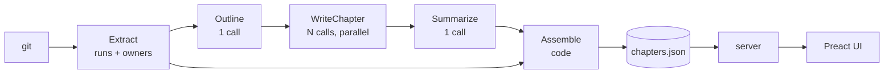

# Chapters MVP — Design Spec

**Date:** 2026-10-20
**Status:** Approved 2026-10-20. Implementation plan: `docs/plans/2026-10-20-chapters-mvp.md`
**Goal:** Find out whether "a branch's changes, re-told as an ordered narrative" is a product worth building. Smallest thing that answers that question.

## 1. What it is

A local CLI. Run `npx chapters` inside a git repo with a feature branch checked out. It analyses the branch's commits, uses an LLM to group the changes into **chapters** with plain-language explanations, and serves a page on `localhost:4173` showing the branch diff, GitHub-style split view, organised as that narrative.

Every change is shown **in its final form** — the line content and line numbers of the final `base → HEAD` diff — but attributed to, and grouped by, the commit that produced it.

### In scope

- Local git analysis of the current branch vs. a base ref.
- Multi-stage LLM pipeline (small prompts, schema-validated outputs).
- Local read-only web page modelled on the mockup (`~/Documents/chapters-mockup.png`), minus the cuts below.
- Local-only "Reviewed" toggles and a Chapter order / File order toggle.

### Out of scope (later)

- Any GitHub integration: PR number/badge, "Open PR on GitHub", comments, threads, resolve, approve/request changes, `markFileAsViewed`.
- Committed `.changes-tree/chapters.json`, freshness rules, CI regeneration.
- changes-tree / interface-change callouts. changes-tree is not part of this product.
- Syntax highlighting.
- Size limits and chunking for very large branches — add only if trials show oversized prompts are a real problem.

## 2. Glossary

| Term | Meaning | Decided by |
|---|---|---|
| **Hunk** | A contiguous block of changed lines (plus context) in one file of the final `base → HEAD` diff — the `@@ -a,b +c,d @@` unit. | git |
| **Run** | A maximal contiguous stretch of changed lines inside one hunk that all have the same owning commit. A hunk has ≥1 runs. | Extract (blame) |
| **Unit** | Runs that touch inside one hunk (no unchanged line between them), whichever commits own them; named by its first run's ID. The LLM stages place units, never part of one, so one unbroken edit is never split across steps because several commits wrote it. Their outputs are expanded back to run IDs; `chapters.json` and the UI keep per-run owners. | `src/shared/units.ts` |
| **Step** | One sentence of explanation + one or more runs, from one or more files (closely related changes, e.g. source + its test, component + its styles). | LLM, stage 2 |
| **Chapter** | An ordered group of steps telling one part of the story. May span files. | LLM, stage 1 |
| **Owner** | The commit a changed line is attributed to. | Extract (blame) |

Example: `callers.py` has one final hunk at lines 41–53. Lines 41–46 were written by commit A, lines 49–52 by commit C → two runs. Outline puts run A in chapter 2 and run C in chapter 4. Chapter 2's step shows the hunk with 41–46 green and 49–52 muted and tagged "ch 4"; chapter 4's step shows the same hunk with 49–52 green and 41–46 as plain context. Lines 47–48 are unchanged, so the runs are separate units; had A's and C's lines touched, they would be one unit, placed and explained together.

## 3. User experience

```
$ npx chapters [--base <ref>] [--port 4173] [--regenerate] [--no-open]
$ npx chapters generate [--base <ref>] [--from <stage>] [--no-cache] [--out chapters.json]
$ npx chapters probe
```

- `probe`: one structured LLM call against the configured gateway; prints and records the result (auth mode, model, latency).

- `chapters` (default `serve`): if `.git/chapters/<headSha>.json` is missing (or `--regenerate`), run the pipeline with per-stage progress on stderr, then serve and open the browser.
- `generate`: run the pipeline and write the JSON; no server. Used for tests and prompt tuning.
- Base ref resolution: `--base` → `origin/HEAD` → `origin/main` → `main`. Error with a clear message if none resolve.
- All output and cache lives under `.git/chapters/`. The working tree is never modified.

## 4. Architecture

Single npm package, TypeScript, Node ≥ 20.

| Module | Responsibility | Depends on |
|---|---|---|
| `src/git/` | Thin typed wrappers over `git` subprocess calls: `mergeBase`, `revList`, `diff`, `blame`, `blameReverse`, `show`. No parsing logic beyond porcelain → objects. | `git` binary |
| `src/extract/` | Branch → `ExtractResult` (files, hunks, lines with owners, runs, commits). Pure logic over `git/` outputs. No LLM. | `git/` |
| `src/llm/` | `LlmClient` interface: `structured<T>(req: {system, user, schema: ZodType<T>, toolName}) → T`. `GatewayLlmClient` (Anthropic SDK) and `FakeLlmClient` (scripted responses). | `@anthropic-ai/sdk`, `zod` |
| `src/pipeline/` | Stages Outline, WriteChapters, Summarize, Assemble; validation, retry, fallback, cache. | `extract/`, `llm/`, `schema/` |
| `src/schema/` | zod schemas + inferred TS types for `chapters.json` and every stage's LLM output. Shared with UI. | `zod` |
| `src/server/` | `node:http`: serves built UI assets and `GET /api/chapters`. | — |
| `src/cli.ts` | Arg parsing, wiring, progress output, browser open. | all |
| `ui/` | Preact + Vite app, built into `dist/ui/` and served statically. | `src/schema/` |



## 5. Extract (deterministic)

1. `baseSha = git merge-base HEAD <baseRef>`; `headSha = git rev-parse HEAD`.
2. Commits: `git rev-list --reverse --no-merges baseSha..HEAD`, with subject, body, author, date.
3. Final diff: `git diff --find-renames --no-color -U3 baseSha HEAD`. Parsed into files → hunks → lines with `oldNo`/`newNo`. **This diff is the sole source of what is displayed.**
4. Owners of `+` lines: `git blame -w --porcelain baseSha..HEAD -- <path>` at HEAD. Line *n* of HEAD → commit SHA (boundary = not changed in branch).
5. Owners of `-` lines: `git blame -w --reverse --porcelain baseSha..HEAD -- <oldPath>` on the base file. Gives the last commit in which each base line still existed; the owner (deleting commit) is that commit's child within `baseSha..HEAD`, taken from `git rev-list --parents baseSha..HEAD`. (Do not add `--first-parent`: git rejects it with `--reverse` once main has been merged into the branch. Verified 2026-10-20.) A child that is a merge commit is outside the commit list → fallback below. Known limitation: a line the branch deleted before main was merged in, in a file main also changed, gets the merge commit as its child, so it falls back and a later edit can own it while the deleting commit owns nothing (scenario S12). Reverse blame follows renames.
6. Runs: walk each hunk; a run is a maximal sequence of consecutive changed (`+`/`-`) lines with the same owner. Context lines break runs. Run ID = first 12 hex of `sha256(path + "\0" + oldRange + "\0" + newRange + "\0" + changed lines joined with "\n", each prefixed by its +/- kind)`.
7. Edge cases:
   - **Added then later edited:** blame gives the later commit. Final-form semantics.
   - **Added then removed within branch:** absent from final diff; not shown.
   - **No net diff** (the branch's commits cancel out): Extract still lands, then generation stops with a user error before any LLM call.
   - **Blame/diff disagreement** (a `+` line blame calls boundary, a `-` line that blame says survived, or an owner outside the commit list e.g. merge resolution): inherit the owner of the nearest preceding changed line in the same hunk; else the nearest following; else the last commit in the list that touched the file (`git log -1 --format=%H baseSha..HEAD -- <path>`).
   - **Binary file:** one content-less run, owner = last commit touching the file. The same applies to any file with no hunks (pure rename, mode-only change, empty new file), so nothing is silently hidden.
   - **Added file:** no reverse blame needed. **Deleted file:** no forward blame needed.
   - **Rename:** `oldPath` recorded; reverse blame uses `oldPath`.
   - **Moved code:** `-M`/`-C` blame flags are a config option, default off.

Output type `ExtractResult = { baseRef, baseSha, headSha, branch, repo, commits[], files[], runs[], ownerFallbacks[] }` (same shapes as §7; `commits[]` also carries `body`; `ownerFallbacks[]` lists every line that hit the disagreement fallback, for the QA tab).

## 6. LLM pipeline

### 6.1 Client

- `@anthropic-ai/sdk` `Anthropic({ baseURL, authToken })`.
- `baseURL` default: `https://eng-ai-model-gateway.sfproxy.devx-preprod.aws-esvc1-useast2.aws.sfdc.cl` (LLM Gateway Express — the sanctioned path for developer tools; personal `api.anthropic.com` keys are prohibited for non-public data). Override: `CHAPTERS_LLM_BASE_URL`.
- Token: `CHAPTERS_LLM_TOKEN`, else stdout of `CHAPTERS_LLM_TOKEN_CMD`, else stdout of `devbar auth claude` when devbar is found (`CHAPTERS_DEVBAR`, then `PATH`, then the devbar app; see `2026-10-26-easy-install-design.md` §4). Missing → clear error with link to the gateway key page. Do **not** read Claude Code's settings: devbar is the SSO path those settings are moving to, and Chapters asks devbar directly.
- Model: `CHAPTERS_MODEL`, default `claude-opus-5-5`; `claude-sonnet-5-5` is the cheaper alternative. Gateway uses bare first-party IDs. Effort: `CHAPTERS_EFFORT`, default `low` for Outline/WriteChapter/Summarize (tune in eval). There is no thinking setting: Chapters sends no thinking field, and on Opus 5.5 that already means adaptive thinking. Effort (with the model) is part of the stage-cache key and recorded on each LLM stage's artifact.
- `structured()`: one request with a single tool named `emit_<stage>`, `strict: true`, `input_schema` generated from the zod schema (`z.toJSONSchema`, with `additionalProperties: false`), `tool_choice: {type: "auto", disable_parallel_tool_use: true}`, and a system line "Respond only by calling the `emit_<stage>` tool." The `tool_use` block's `input` is then `safeParse`d. No `tool_use` block → treated as a validation failure (retry path).
  - Forced `tool_choice` (`tool`/`any`) is **not** usable: Opus 5.5 and Sonnet 5.5 return 400.
  - `output_config.format` (JSON-schema structured outputs) is **not** honoured through the gateway: the response came back as fenced Markdown text, so constrained decoding is not being applied. Don't rely on it.
- Concurrency ≤ 4 in-flight; exponential backoff on 429/5xx (gateway default limit 50 req/min).
- **Probe results (2026-10-20, curl against the gateway):** native `POST /v1/messages` works; both `Authorization: Bearer` and `x-api-key` authenticate with a gateway key; `GET /v1/models` lists `claude-opus-5-5`, `claude-sonnet-5-5`, `claude-haiku-5-5` and others; strict tool + `auto` returned a clean `tool_use` block with schema-valid input on both Opus 5.5 and Sonnet 5.5. `chapters probe` (milestone 2) repeats this check through the SDK on each user's machine.

### 6.2 Stages

**Stage 1 — Outline (1 call)**
- In: branch name; commits (short SHA, subject, body); unit index (called runs in the prompt) — per unit: `id`, `path`, owner short SHAs, `+added −removed`, enclosing hunk header, first 3 changed lines.
- Out: `{ chapters: [{ key, headline, runIds: string[] }], excluded: [{ runId, reason }] }`.
- Validate (on unit IDs; the output is then expanded to run IDs, an excluded unit giving each of its runs the same reason): every run ID appears exactly once across `chapters[*].runIds ∪ excluded[*].runId`; no unknown IDs; 1 ≤ chapters ≤ 12; no empty chapter; unique keys.
- Prompt guidance: chapters may regroup runs freely across commits and files; order so definitions precede uses; commit history is a hint, not a constraint; put generated/lock/vendored files in `excluded`.

**Stage 2 — WriteChapter (one call per chapter, parallel)**
- In: this chapter's headline; all chapter headlines in order (for arc awareness); its units with ±3 context lines from the final hunk; commit messages of its runs' owners.
- Out: `{ intro: string, steps: [{ runIds: string[], explanation: string }] }`. Intro 1–2 sentences; each explanation one sentence.
- Validate (on unit IDs, then expanded to run IDs): steps' run IDs = exactly this chapter's runs, each once; non-empty strings. A step may mix files.

**Stage 3 — Summarize (1 call, after stage 2)**
- In: headlines + intros, branch name, commit subjects.
- Out: `{ title, summary }` — title is the page heading; summary is the "What this PR does" paragraph (≤ 80 words).

**Stage 4 — Assemble (code)**
- Join Extract + stage outputs into `chapters.json` (§7). Assign `number` by order. Final assertion: every run is in exactly one step or in `excluded`. Assertion failure is a bug → throw.

### 6.3 Retry, fallback, cache

- Each LLM stage: on schema/validation failure, retry once with the validation error appended to the user message. Second failure → fallback, recorded in `fallbacks[]`:
  - Outline → one chapter per commit (headline = commit subject), units by their first run's owner; nothing excluded.
    Commits past the 12th merge into chapter 12 (headline gains "(and N more commits)"); a repeated key gets `-2`, `-3`…; an empty subject becomes `Commit <sha7>`.
  - WriteChapter → one step per file (runs in file order), `explanation = ""`, `intro = ""`.
  - Summarize → `title = branch name`, `summary` = commit subjects joined.
- Network/auth errors are not retried into fallback; they abort with a clear message.
- Cache: `.git/chapters/cache/<sha256(stage, PROMPT_VERSION, model, effort, canonicalInput)>.json`. Hit → skip call. `--regenerate` bypasses the final-output cache but still uses the stage cache unless `--no-cache`.
- No size limits. An oversized prompt surfaces as the gateway's error, which aborts with a clear message like any other API error.

## 7. `chapters.json` (version 1)

```ts
type ChaptersFile = {
  version: 1;
  repo: string;            // basename of repo top-level dir
  branch: string;
  baseRef: string; baseSha: string; headSha: string;
  generatedAt: string;     // ISO 8601
  model: string;
  promptVersion: string;
  fallbacks: ("outline" | `write:${string}` | "summarize")[];
  title: string;
  summary: string;
  commits: { sha: string; subject: string; author: string; date: string }[];
  files: {
    path: string;
    oldPath?: string;
    status: "added" | "modified" | "deleted" | "renamed";
    binary: boolean;
    hunks: {
      header: string; oldStart: number; oldLines: number; newStart: number; newLines: number;
      lines: { kind: " " | "+" | "-"; oldNo?: number; newNo?: number; text: string; runId?: string }[];
    }[];
  }[];
  runs: { id: string; path: string; commitSha: string; added: number; removed: number;
          oldRange?: [number, number]; newRange?: [number, number] }[];
  chapters: { key: string; number: number; headline: string; intro: string;
              runIds: string[]; steps: { runIds: string[]; explanation: string }[] }[];
  excluded: { runId: string; reason: string }[];
};
```

Every displayed line comes from `files[].hunks[].lines`; runs and steps reference lines only by `runId`. The UI never calls git.

## 8. UI

Preact + Vite, light GitHub Primer-like palette, Inter + JetBrains Mono, layout per mockup.

- **App bar:** "Chapters" brand, repo name, branch, `localhost:<port>` indicator.
- **Header:** `title`; `baseRef ← branch`; "N commits"; "generated for `<headSha short>`". Server includes current HEAD in `/api/chapters`; if it differs from `headSha`, show "HEAD has moved — rerun `chapters --regenerate`". If `fallbacks` is non-empty, show "Generated with fallback for: …".
- **Left rail:** ordered chapter list with state (reviewed / current / to-do) and `N files · +a −r`; "k of N reviewed" progress bar; "Not in a chapter" bucket listing excluded runs grouped by path with reasons — clicking shows that run's plain diff.
- **Main column:** "What this PR does" summary with Chapter order / File order toggle; then chapters. The first unreviewed chapter is expanded; others collapsed to headline + intro + files + stats.
- **Chapter (expanded):** number badge, headline, files, owner commits (short SHAs), Reviewed toggle, intro, vertical step line, steps.
- **Step:** explanation bullet, then one diff block per file, in the order the step lists its runs (consecutive runs in one file share a block). Each block has a file header, then one split diff per hunk the step's runs touch, in diff order. Left = base (`oldNo`), right = HEAD (`newNo`).
  - **Window:** the step's runs ± 3 lines. Outside the window → collapsed bar "▸ N lines · M from ch K…" (expandable).
  - **Line coloring inside window:**

    | Line owner | Style |
    |---|---|
    | This step's runs | Standard green `+` / red `−` |
    | Earlier chapter (or earlier step, same chapter) | Plain context styling, keeps `+`/`−` gutter marker dimmed |
    | Later chapter (or later step, same chapter) | Muted tint (distinct hue), right-aligned "ch N" tag |
    | Excluded run | Gray, "not in a chapter" tag |
    | Unchanged context | Plain |

  - Later-chapter lines inside the window are shown inline, never collapsed. Windows only join across a gap of ≤ 6 lines, so any longer stretch is already behind a bar (decided 2026-10-23, M9).
  - Expanded bars render lines with the same coloring rules.
- **Reviewed:** toggle per chapter, persisted in `localStorage` key `chapters:<repo>:<headSha>`. Marking reviewed collapses it and expands the next unreviewed chapter.
- **File order view:** final diff grouped by file in path order; each changed line carries a small chapter-number badge (or "—" if excluded). Same collapse rules relative to hunks (±3 context, standard).

## 9. QA views and build order

Every pipeline stage must be inspectable in the browser on its own, independent of the final UI. The server and QA views are built **first**; each later milestone lands with a QA view, so progress is checked in the browser rather than only in tests.

### 9.1 Stage artifacts

Each stage (Extract, Outline, each WriteChapter, Summarize, Assemble) writes an artifact to `.git/chapters/runs/<headSha>/<stage>.json`:

```ts
type StageArtifact = {
  stage: "extract" | "outline" | `write:${string}` | "summarize" | "assemble";
  startedAt: string; durationMs: number;
  cacheHit: boolean;
  input: unknown;                       // the canonical input object
  attempts: {                           // empty for code-only stages
    system: string; user: string;       // rendered prompt
    rawResponse: unknown;               // tool input as returned
    validationErrors: string[];         // [] = passed
    usage?: { inputTokens: number; outputTokens: number };
  }[];
  output: unknown;                      // parsed, validated output (or fallback)
  fallbackUsed: boolean;
  error?: string;                       // set when the stage failed (e.g. Assemble coverage assertion)
};
```

### 9.2 Server routes

- `GET /api/stages` → list of artifacts present for current HEAD (stage, status, duration, fallback flag).
- `GET /api/stages/:stage` → full artifact.
- `GET /api/chapters` → final `chapters.json` (+ current HEAD).
- `GET /api/probe` → last `chapters probe` result (`.git/chapters/probe.json`).
- Static UI at `/` (final view) and `/qa` (QA views).

### 9.3 QA pages (`/qa`, one tab per stage)

Plain, functional styling; they need not resemble the final product.

- **Extract:** commits list; per file, the final hunks with each changed line color-coded by owner commit (legend by commit), run boundaries and run IDs marked; a counts table (files, hunks, runs, lines per commit); a list of lines that hit the blame/diff-disagreement fallback.
- **Outline:** rendered prompt; raw response; validation errors per attempt; chapters → run IDs table (each run expandable to its lines); excluded runs with reasons; coverage check result.
- **WriteChapter (per chapter):** prompt, raw response, validation per attempt; intro and steps, each step with its run lines inline.
- **Summarize:** prompt, response, title and summary.
- **Assemble:** final coverage assertion result; `chapters.json` raw (collapsible).
- Every tab shows: duration, cache hit, token usage, fallback flag.

### 9.4 Re-running a stage

`chapters generate --from <stage>` reuses cached upstream artifacts and re-runs the named stage and everything after it, bypassing the stage cache for those stages.

Each QA tab also has a **Re-run from here** button → `POST /api/stages/:stage/rerun`. The server runs the same code path as `--from <stage>` in-process, one job at a time (a second request while a job runs → `409`). `GET /api/jobs/current` returns `{ stage, status: "running" | "done" | "failed", error? }`; the QA page polls it every second and reloads artifacts when done. Previous artifacts are kept as `<stage>.prev.json` so the tab can show a "previous attempt" diff of the output.

### 9.5 Build order (milestones, each QA-able in the browser)

1. Skeleton: CLI + `node:http` server + Vite/Preact shell with `/qa` route and `/api/stages` returning a hard-coded artifact.
2. Gateway probe (`chapters probe`): one structured call; result shown on a `/qa` "LLM" tab.
3. Extract → Extract QA tab.
4. LLM client + Outline → Outline QA tab.
5. WriteChapter → WriteChapter QA tabs.
6. Summarize + Assemble → Summarize and Assemble tabs.
7. Final chapter UI at `/` (§8).
8. File-order view, reviewed state, banners, README, trial packaging.

## 10. Testing

TDD throughout; vitest.

- **Fixture repos:** `makeRepo(spec)` builds a real git repo in a temp dir from a declarative commit list (fixed author, `GIT_AUTHOR_DATE`/`GIT_COMMITTER_DATE`) for determinism. Scenarios:
  1. single commit, new file
  2. function built across 3 commits
  3. branch deletes base lines
  4. line added in c1, edited in c3
  5. line added then removed within branch
  6. rename with edits
  7. deleted file
  8. binary file
  9. main merged into branch mid-way
  10. blame/diff disagreement (forced via whitespace or reordering)
- **Extract:** exact expected runs and per-line owners per scenario. Highest test density.
- **Pipeline:** `FakeLlmClient` with scripted outputs (valid, invalid-then-valid, invalid-twice): validation, retry-with-error, each fallback, coverage assertion, cache hit/miss.
- **Prompt snapshots:** golden files of each stage's rendered input for fixture 2, so prompt changes are visible in review.
- **UI:** `@testing-library/preact` against fixture `chapters.json`: owner coloring, collapse bars and thresholds, reviewed persistence, file-order badges, stale-HEAD and fallback banners.
- **E2E:** CLI against fixture repo with fake LLM (`CHAPTERS_FAKE_LLM=<script.json>`); server starts; fetch `/` and `/api/chapters`; schema-validate.
- **Live eval (manual):** `npm run eval -- <repoPath> <branch>` against the real gateway; writes JSON + opens page for human judgement.

## 11. Distribution and trial

- Trial install: `npx git+https://<internal-git-host>/<org>/chapters.git` with a `prepare` script that builds UI and CLI. Internal npm registry later.
- README: install, getting a gateway key, env vars, troubleshooting.
- **Trial:** 3–5 teammates on their own branches (≤ ~2k changed lines, ≤ ~30 commits).
- **Success:**
  - installs and runs first time without help;
  - generation < 90 s for trial-sized branches;
  - ≥ 3 of 5 say they'd rather read it than the GitHub diff;
  - collect specific bad-split / bad-explanation notes.

## 12. Risks

- **Gateway quirks** (forced tool_choice rejected, `output_config.format` ignored) → strict tool + `auto` + validation retry; `chapters probe` re-checks per machine.
- **Gateway future** after the Claude Enterprise rollout is unannounced → base URL and token are config, not hard-coded assumptions.
- **Blame noise** (whitespace, moved code) → `-w` on; `-M`/`-C` configurable.
- **Data classification:** internal source code only; never customer data (gateway rule). README states this.
