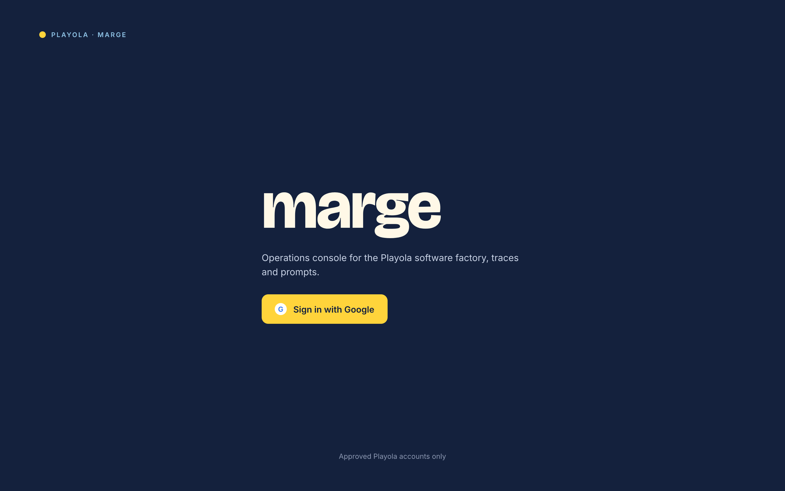
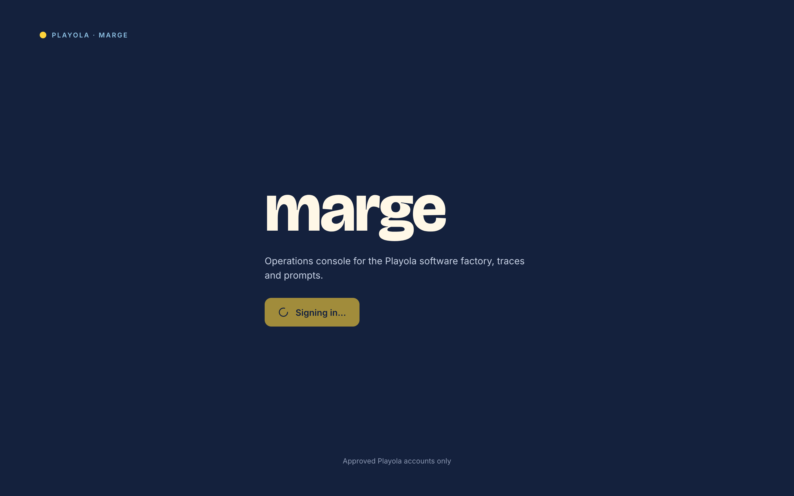
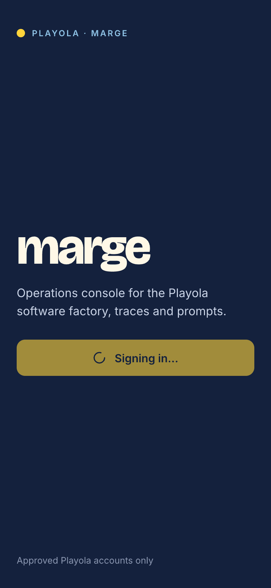
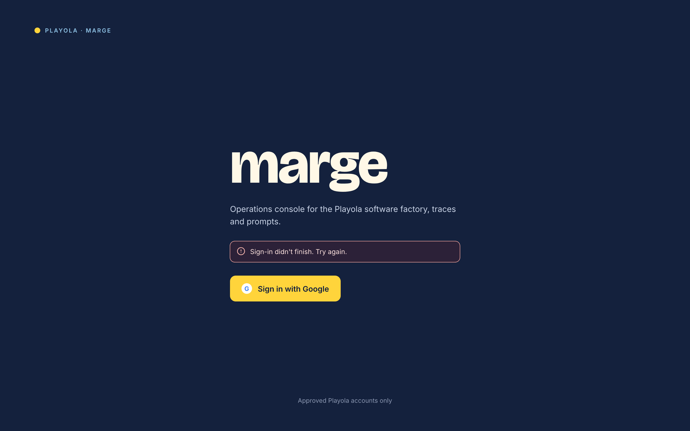
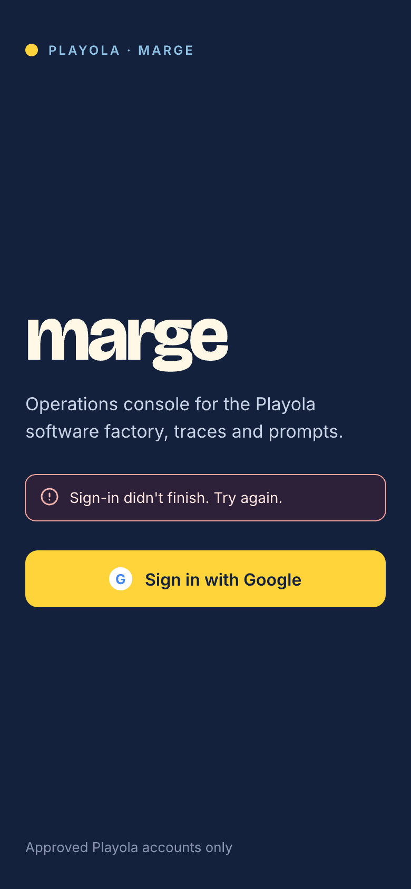
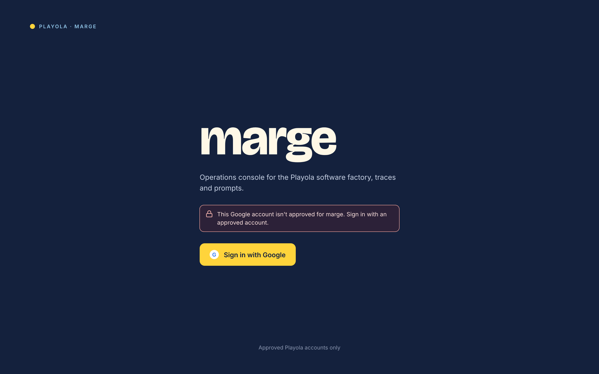
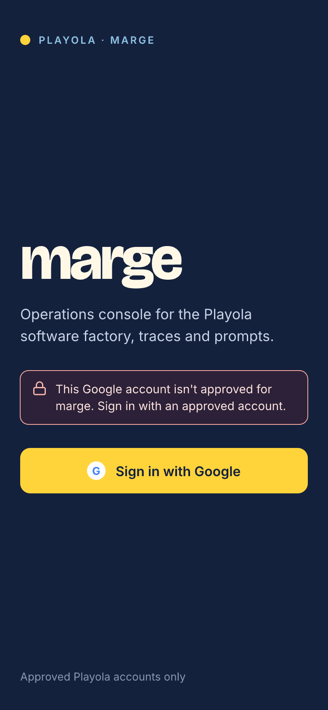
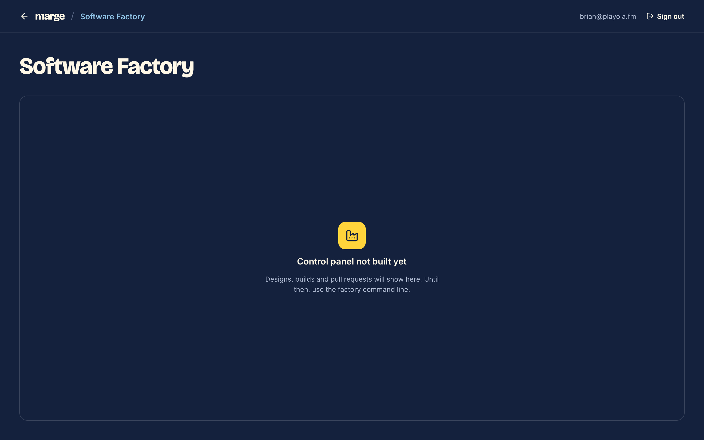
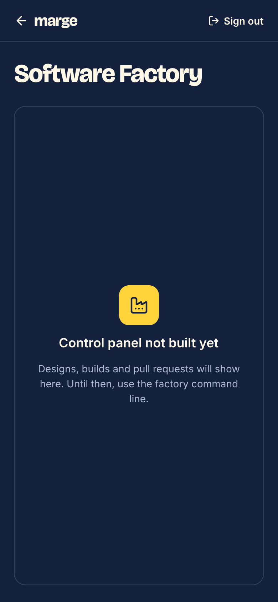

# 001 — Sign in to Marge and open the factory

**Repo:** `marge-web` (client `client/`, server `server/`). Base branch: `main` (repo default; no `develop`).
**Factory read at:** `~/playola/factory` @ `bbf7004`. **Playola (auth pattern copied) read at:** `~/playola/playola`
`develop` @ `5a2d86006`.

## Who and why

**Who:** Brian and a small allowlist of Playola operators. Never the public beyond the landing page.

**Intent:** Give marge a front door: a public landing page, Google sign-in limited to allowlisted
emails, and a signed-in title screen whose menu leads to the software-factory control panel. Later slices hang
traces, prompt tuning and every other marge-control feature off that same title-screen menu.

**Out of scope:** the factory control panel's contents (design 002 — including how factory state gets from the
machine running `factory` to this site), traces, prompt editing, user management UI (the allowlist is server
config), sign-in providers other than Google.

**Realistic sizes:** allowlist ≤ 10 emails; title-screen menu 1 item now, ≤ 6 ever.

## Screens

Canvas: `design/marge.pen`. Every screen is drawn at desktop (1440×900) and phone (390×844).

### Landing — default

**Address:** `/`. **Reached by:** opening the site signed out; signing out; opening `/home` or `/factory` signed
out (redirects to `/?redirectTo=<path>`); a stored token that has expired. **Left by:** "Sign in with Google" →
Google's consent popup. A signed-in visitor to `/` is sent straight to `/home` (or `redirectTo`).

### Landing — signing in

While the Google popup is open and while the code is exchanged: the button shows a spinner and "Signing in…" and
ignores further taps. **Left by:** success → `redirectTo` or `/home`; failure → one of the two error states.

### Landing — sign-in failed

Popup closed or errored, or the server answered 400 / 401 / 500. Banner: "Sign-in didn't finish. Try again." The
button stays usable.

### Landing — not approved

Server answered 403 `not_approved`. Banner: "This Google account isn't approved for marge. Sign in with an approved
account." The button stays usable so another account can be tried.

### Title screen — default

**Address:** `/home` (signed in only). **Reached by:** successful sign-in; "← marge" on the factory page; visiting
`/` signed in. **Left by:** "Software Factory" → `/factory`; "Sign out" → clears the stored token → `/`. Shows the
email from the stored token. No loading or error state: the page makes no server call.

### Software Factory — not built yet

**Address:** `/factory` (signed in only). **Reached by:** the title-screen menu, or the address directly. **Left
by:** "← marge" → `/home`; "Sign out" → `/`. Body: "Control panel not built yet" with one line of explanation. The
control panel replaces this body in design 002. No loading or error state: the page makes no server call.

## Decisions

1. **Sign-in:** one "Sign in with Google" button; the server admits only emails on an allowlist. No passwords stored.
2. **Title screen:** a signed-in home with a menu. Only "Software Factory" is shown now; Traces / Prompts appear in
   the menu only once built (no disabled placeholders).
3. **Marge's face:** the owner-supplied image `design/marge-face.jpeg`, used as-is as one swappable asset, shown
   **only after sign-in** (title screen). The public landing page shows no picture.
4. **Factory page in this slice:** an empty control-panel shell (header, nav back to the title screen, a body that
   says the panel is not built yet). The panel itself is design 002.
5. **Mobile is first-class:** every screen is drawn at desktop (1440×900) and phone (390×844); both must work, not
   just shrink.
6. **Landing layout:** a full navy page: brand line top-left, then a centered column (wordmark, one-line
   description, yellow "Sign in with Google" button), access note at the bottom. No picture and no decoration.
   Sign-in errors show as an inline banner above the button; while signing in, the button shows a spinner and
   "Signing in…".
7. **Title screen layout:** the split composition: a navy panel (brand line, wordmark, menu, signed-in email and
   "Sign out") beside Marge's picture; on phone the picture sits on top.
8. **Session (copied from Playola's web client):** Google auth-code popup → `POST /v1/auth/google/signin` →
   token stored in `localStorage` and sent as a Bearer header; sign-out is client-only. Because the pages read the
   signed-in user from the stored token, there is no "checking session" or "server unreachable" state.
9. **Token lifetime: 30 days** (Playola's never expire). An expired stored token counts as signed out. Removing an
   email from the allowlist takes effect when that person's token expires, or at once for everyone by rotating
   `JWT_SECRET`.
10. **Allowlist** lives in the `MARGE_ALLOWED_EMAILS` env var in Render, compared case-insensitively. No database
    table and no management screen.
11. **Google client:** a new Google OAuth web client just for dashboard sign-in, in its own Google Cloud project
    "Marge Web" (so the consent popup says marge and Playola's own sign-in is untouched); the server holds its secret. Our own
    yellow button starts the popup.
12. **Addresses:** `/` landing, `/home` title screen, `/factory` factory page. Signed-out visits to `/home` or
    `/factory` go to `/?redirectTo=<path>` and return there after sign-in (Playola's `ProtectedRoute` pattern).

13. **Setup happens during design, not in the build:** the Google OAuth web client and the Render settings
    (`GOOGLE_SIGNIN_CLIENT_ID`, `GOOGLE_SIGNIN_CLIENT_SECRET`, `MARGE_ALLOWED_EMAILS`, plus a confirmed
    `JWT_SECRET` in the `production` env group) are created by the owner before this folder is handed to the
    factory. The client ID is recorded in ApiContract.md → Configuration so PR 2 can put it in `netlify.toml`.
    Both PRs are built by the factory.

14. **Dev sign-in for local development (copied from Playola's `/dev-user`):** in a development build, opening
    `/dev-user` calls `POST /v1/auth/dev-login`, stores the returned token like a real sign-in, and goes to `/home`.
    You are then signed in as `dev@marge.local` without Google or the allowlist. The page shows only "Signing in as
    the dev user…" (or "Dev sign-in failed") as plain text; it is a developer tool, so it is not drawn.
    - The server mounts the endpoint only when `NODE_ENV` is exactly `development` or `test`; unset counts as off.
    - The client registers `/dev-user` only when `import.meta.env.DEV`. On `marge.playola.fm` both are absent, and
      `/dev-user` is handled like any unknown address: it goes to `/`, which shows the landing page when signed out
      and the title screen when signed in.
    - Local machines (including Marge's) therefore need no Google secrets and never hold production's
      `JWT_SECRET`.

### Stored data

No stored model changes, so there is no `ModelChanges.md`. Considered and left out:

- **`users` table:** the allowlist and the token already say who someone is; nothing in this slice needs a row.
- **`allowed_emails` table:** ≤ 10 entries edited by an engineer; the env var is enough (decision 10).
- **Server-side session / revocation list:** decision 9 accepts expiry-or-rotate as the way to lock someone out.

### Audit (step 6)

1. **Consistency:** auth flow, storage keys, `redirectTo` handling and error envelope match Playola's client and
   this server's relay (`{ "error": "<code>" }`). New route lives under `/v1` like `/v1/me`.
2. **Completeness:** every signed-in page has Sign out and a way back; every sign-in failure leaves the button
   usable; nothing is created, so nothing needs editing or removing.
3. **Fewer inputs:** one button; the email comes from Google; nothing is typed.
4. **One source of truth:** who may sign in = `MARGE_ALLOWED_EMAILS`; who is signed in = the stored token.
5. **Fewest fields:** token payload is `email`, `name`, `iat`, `exp` only.
6. **Copy and density:** functional copy only; the menu holds 1 item now and has room for 6 without scrolling on
   phone.

## Done when

- [ ] 1. Opening `marge.playola.fm` signed out shows the landing page with the wordmark and "Sign in with Google", and no picture, on desktop and phone.
- [ ] 2. Signing in with an approved Google account lands on the title screen with Marge's picture, the "Software Factory" menu item and the signed-in email.
- [ ] 3. Signing in with a Google account not on the allowlist shows "This Google account isn't approved for marge." on the landing page and stays signed out.
- [ ] 4. Closing the Google popup without finishing shows "Sign-in didn't finish. Try again." and the button works again.
- [ ] 5. While sign-in is in progress the button shows a spinner and "Signing in…" and can't be tapped twice.
- [ ] 6. Tapping "Software Factory" opens `/factory` showing "Control panel not built yet"; "← marge" returns to the title screen.
- [ ] 7. "Sign out" on the title screen or the factory page returns to the landing page, and reloading stays signed out.
- [ ] 8. Opening `/factory` signed out shows the landing page, and signing in returns to `/factory`.
- [ ] 9. Reloading `/home` or `/factory` while signed in keeps you signed in.
- [ ] 10. A stored token older than 30 days is treated as signed out.
- [ ] 11. Every screen fits a 390-pixel-wide phone with no sideways scrolling and every button reachable with a thumb.
- [ ] 12. On a local development machine, opening `/dev-user` signs in as `dev@marge.local` and shows the title screen; on `marge.playola.fm`, `/dev-user` signs no one in and is handled like any unknown address (landing page when signed out, title screen when signed in).
