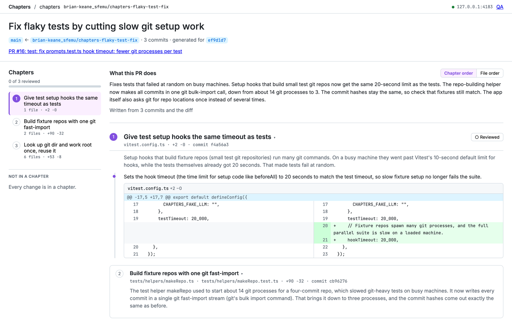

# 003 — PR Reviewer: generate and read chapters

**Who uses it:** playola team members — the Google-allowlisted accounts that already sign in to marge.playola.fm.

**Intent:** Visit `marge.playola.fm/pr-reviewer/<org>/<repo>/pulls/<n>` and read that GitHub pull request as LLM-narrated, ordered "chapters" instead of a raw file diff, marking each chapter reviewed as you go. Everything — generated chapters, progress, and your reviewed marks — lives in the server's database, so a refresh, another device, or a redeploy loses nothing.

**Out of scope (later slices):** asking the LLM about lines or the PR in general (slice 004); drafting comments, submitting a GitHub review, showing existing PR comments, and the per-user GitHub OAuth link those need (slice 005); the subscription LLM backend (the LLM client ships behind an interface so it can be added without redesign).

**Realistic sizes:** a PR produces 1–20 chapters (the reference PR: 7 chapters for 41 files / ~2,700 changed lines); a chapter has 1–10 steps; the page renders diffs up to a few thousand changed lines in one scroll (the layout in the reference capture is proven at that size). A PR accumulates a handful of runs as it gets new commits. Org-wide there are ~400 PRs/month; expected use is a subset, generated on demand.

**Source material:** this design ports the proven "chapters" app (local CLI + Preact UI). Its pipeline, diff-extraction rules, and chapter schema are the reference implementation; this slice re-hosts them server-side in marge-web with Postgres persistence. The chapters source code itself is **not** in this repository: the authoritative sources for implementation are the design specs bundled in `reference/` (`chapters-mvp-design.md` — pipeline, extraction, chapter schema, tests; `chapters-pr-mode-design.md` — PR-scoped fetch and revision pinning; `chapters-markdown-rendered-diff-design.md` — markdown diff rendering) plus the capture in `screenshots/` — "port" throughout these files means re-implementing to those specs. Backend note: this feature is self-contained in marge-web (no playola monorepo endpoints are called).

## Screens

One screen — the PR reviewer page — in its states. Client route `/pr-reviewer/:org/:repo/pulls/:prNumber`, wrapped in the existing `ProtectedRoute`. Reached by visiting the URL directly (take a GitHub PR URL, replace `github.com` with `marge.playola.fm/pr-reviewer` and `/pull/` with `/pulls/`). Left by browser navigation or sign-out. There is no index page in this slice.

### Chapters — ready

Reference capture from the original chapters app; the marge-web port keeps this layout:

- **Header:** PR title, `base ← head` branch chips, commit count, "generated for `<short-sha>`", and a link to the PR on GitHub.
- **Left rail:** numbered chapter list with per-chapter file/`+N −M` counts, the active chapter highlighted, an "N of M reviewed" progress line and bar, and a "NOT IN A CHAPTER" section listing changes the outline left out ("Every change is in a chapter." when none).
- **Main column:** "What this PR does" summary paragraph with its provenance line ("Written from N commits and the diff"), then one card per chapter in order: title, file list with counts and commit, step explanations, and split (side-by-side) diffs per file block with line numbers and add/remove shading. A changed markdown file renders as markdown with this step's changes highlighted, with a per-block **Rendered / Code** toggle, per `reference/chapters-markdown-rendered-diff-design.md` (its asks/comments/threads parts belong to slices 004–005); when a file's stored source is unavailable the block falls back to the code diff with a note. A **Reviewed** toggle sits on each chapter card.
- **Top right of the content area:** "Chapter order / File order" toggle switching between narrated order and a plain per-file view.

The port swaps chapters' local AppBar items (local server address, QA link) for marge-web's standard chrome (brand, sign-out).

### Chapters — generating

No capture (canvas skipped — see Decisions). Same header once PR metadata is known; the content area shows the run's progress: the stage sequence **Fetching the repo → Reading the diff → Outlining → Writing chapters (k of n) → Summarizing**, with the current stage active and a note that the page can be closed and revisited — generation continues server-side. The page polls the run status every few seconds. First generation of a typical PR takes 1–3 minutes.

### Chapters — failed

No capture. The header (from the run's stored PR metadata) plus an error card: a plain-English failure line (e.g. "Generation failed while writing chapter 3"), the underlying error detail collapsed, and a **Retry** button. Retry re-enqueues **this run** — the same pinned revision, even if the PR has since moved; completed stage outputs are cached in the database, so a retry only redoes the failed stages. If the PR has newer commits, the superseded banner appears alongside, offering **Generate for latest** as the alternative.

### Chapters — superseded revision

No capture. The ready page with a banner above the summary: "These chapters were generated for `<short-sha>`; the PR has changed." with a **Generate for latest** button. Reading the old revision stays possible; generating for the latest creates a new run with fresh reviewed marks. Freshness comes from a read-only lookup that compares the run's pinned head and base SHAs with the PR's current head and merge-base SHAs on page load and when the window regains focus — nothing generates without the button. **A freshness lookup never switches the page away from the run being read.** When it discovers a newer run matching both current SHAs already exists (another user pressed Generate for latest — the lookup returns that run alongside the one being read, with its id and status), the banner changes to say chapters for the latest revision are generating, failed, or ready (whichever the newer run's status is — including when a later lookup returns that run as its readable result while an older document is on screen) with a **View latest** button that opens that run — switching runs is always that explicit action. On a fresh load or refresh, the lookup resolves to the newest *ready* run when one exists (else the newest run of any status), so a reader arriving mid-generation still gets readable chapters with the banner; once the newer revision's chapters are ready, a fresh load shows those.

### Chapters — empty diff

No capture. Message card: the PR has no changes between its merge base and head (or the PR URL doesn't resolve to an open PR — that variant names the lookup failure). No generation is started for an empty diff.

### Chapters — unavailable / request error

No capture. Distinct from a **failed run** (which has Retry): this is the page itself failing to read. When the initial lookup answers `503` (the server runs without the reviewer configured) the card says the PR reviewer isn't available on this server; for any other request failure it says the request failed, with the error detail collapsed. Both show a **Try again** button that re-runs the read — it never starts generation. Recovery is read-only even when it succeeds: if the recovered lookup finds the PR has no run yet, the page does **not** auto-generate (only an untroubled first visit does) — it shows the PR header with a **Generate chapters** button, and generation starts only when that is pressed. When a document is already on screen, a failed freshness lookup or poll does not blank the page: the chapters stay readable and a dismissible note reports the lookup failed.

### Loading / signed out

Brief "Loading…" status while the first fetch resolves (ported from chapters' live-region pattern). Signed-out visitors land on marge-web's existing sign-in screen (unchanged, existing `ProtectedRoute` behavior — not redrawn here).

## Decisions

- **D1 — Canvas skipped (owner decision).** The owner chose to port chapters' proven UI rather than redraw it on the pencil canvas: one reference capture plus prose state descriptions stand in for pencil frames. Risk accepted: the factory builds from prose and one reference image instead of pixel-exact frames.
- **D2 — Review identity (recorded now, built in slice 005).** Users will OAuth into GitHub *through marge-web*; reviews and comments post to GitHub **as the user**, from this page, without leaving it. The marge-reviewer GitHub App's installation tokens are used for all *reads* (PR metadata, diffs, comments). Nothing posts as the bot.
- **D3 — On-demand, shared generation.** Chapters are generated on first visit, not per webhook. Two users opening the same PR revision share one run and one LLM bill; a run is unique per (org, repo, PR, base SHA, head SHA, pipeline version).
- **D4 — No persistent disk.** Server-side git clones live in a bounded, ephemeral cache (per-PR shallow fetch pinned to SHAs, LRU eviction, size caps). The assembled chapters persist in Postgres, so reading survives eviction and redeploys. This keeps the web service horizontally scalable and avoids a Render disk add-on.
- **D5 — Postgres off the free plan (owner decision).** `marge-api-db` moves from `free` to `basic-256mb` in this slice — free-tier databases expire after 30 days with no backups, and review history must survive.
- **D6 — API-first LLM behind an interface.** The server calls the Anthropic API directly (`claude-opus-5-5`, structured tool-schema outputs with zod validation). On a validation failure a stage retries once with the validation error appended; a second failure uses the reference's deterministic stage fallback (outline → one chapter per commit; write → one step per file with empty explanation; summarize → branch name + joined commit subjects), recorded in the document's `fallbacks[]` (reference §6.3). Network/auth errors are not retried into fallback — the attempt fails with a clear message. Stage results are cached by content hash. The client code sits behind an `LlmClient` interface so a subscription backend (Claude Agent SDK + OAuth token) can be added later by env config.
- **D7 — Reviewed marks are per-user and per-revision.** A mark belongs to (run, chapter, user email from the marge JWT). A new revision's run starts unmarked for everyone.
- **D8 — In-process job runner.** Generation runs inside the Express service (Postgres rows are the queue; leases + attempt counts give crash recovery; stage cache makes re-runs cheap). It moves to a Render background worker only if measured latency or memory demands it.
- **D9 — The document is stored and served verbatim.** The pipeline assembles the extended chapters.json v1 document (reference §7 + PR-mode `pr` field) and it is persisted and served unchanged; the ported UI renders it as chapters' UI does. No adapter schema. Markdown file sources needed by the rendered view are captured during extraction, while the git cache still holds the revision, and persisted with the document, so the rendered view also survives git-cache eviction.

## Audit

Checked against the marge-web code and conventions before planning: the route and API sit behind the existing `ProtectedRoute` / `authenticate` JWT middleware (consistency); every state in Screens is reachable and leavable with no dead ends — failed has Retry, superseded has Generate-for-latest, reviewed marks can be set and cleared (completeness); the page asks the user for nothing the system knows — org/repo/PR come from the URL, identity from the JWT, revision from GitHub (fewer inputs); the run row is the single source of truth for status and the database for marks — nothing is duplicated client-side (one source of truth); the schema adds no speculative columns (fewest fields — see ModelChanges.md for fields considered and left out); copy is functional and the reference layout is proven at the sizes in scope (copy and density).

## Done when

- [ ] Visiting `marge.playola.fm/pr-reviewer/<org>/<repo>/pulls/<n>` while signed in starts generation for that PR on first visit and shows stage progress until the chapters are ready.
- [ ] The finished page shows the PR summary, ordered chapters with step explanations and side-by-side diffs, and the "not in a chapter" section, matching the reference capture's layout.
- [ ] Toggling **Reviewed** on a chapter persists: after a refresh or from another browser, the same account sees the same marks and the correct "N of M reviewed" count.
- [ ] A second signed-in user opening the same PR revision gets the already-generated chapters (no second generation) but their own independent reviewed marks.
- [ ] When the PR gains new commits after generation, the page says the chapters are for an older revision and **Generate for latest** produces chapters for the new head.
- [ ] A failed generation shows what failed and **Retry** completes the run without redoing already-completed stages.
- [ ] Generated chapters remain readable after the server redeploys or its git cache is cleared.
